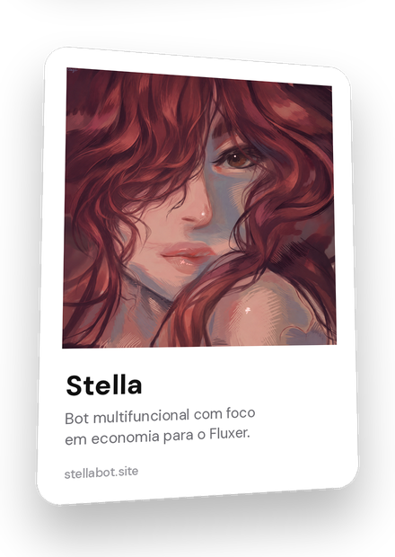
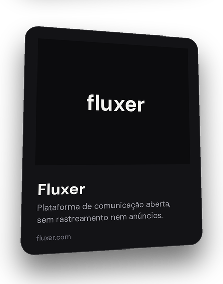

 

**Construindo software brasileiro com autonomia e código aberto.**

 

 

## O que a gente faz

- **Expansão do [Fluxer](https://fluxer.com) no Brasil**: comunicação aberta e livre, sem rastreamento nem anúncios.
- **Chat, voz e comunidades em código aberto de verdade**: não confiamos em corporações, confiamos em transparência.
- **Software brasileiro**: ajudando a criar uma nova era, mais segura e eficiente para todos.

 

## Projetos e links

<table>
  <tr>
    <td align="center">
      
    </td>
    <td align="center">
      
    </td>
    <td align="center">
      
    </td>
    <td align="center">
      
    </td>
  </tr>
</table>

 

  

