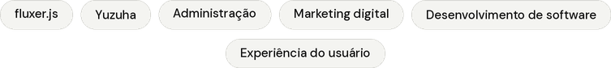
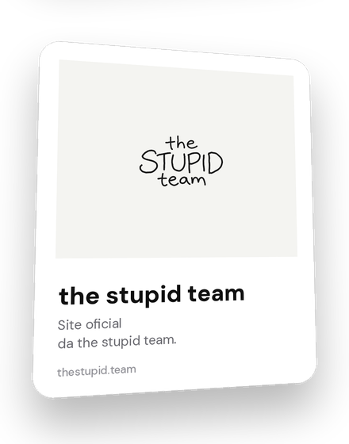

 

<h2 align="center">O que a gente faz</h2>

  <b>Expansão do <a href="https://fluxer.com">Fluxer</a> no Brasil</b>: comunicação aberta e livre, sem rastreamento nem anúncios.
    
  <b>Chat, voz e comunidades em código aberto de verdade</b>: não confiamos em corporações, confiamos em transparência.
    
  <b>Software brasileiro</b>: ajudando a criar uma nova era, mais segura e eficiente para todos.

 

<h2 align="center">Projetos e links</h2>

<table>
  <tr>
    <td align="center">
      
    </td>
    <td align="center">
      
    </td>
  </tr>
</table>

 

  

